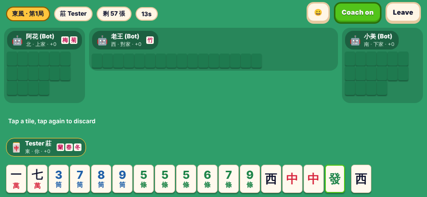

# Mahjong Mania 🀄

**Taiwanese 16-tile Mahjong (台灣麻將) for iOS and Android: verifiable online tables, clubs with house rules, and a coach that teaches you while you play.**

Think PokerBros for Mahjong: create a private table, share a six-character code, and play with friends anywhere.
Online tables run on the game server. Every seat and the server commit to a secret before any tile is dealt,
and every phone re-derives the seed and replays the hand afterwards: every hand is logged and checked on your phone. Bots fill
empty seats so a table always runs; offline you play the same engine against bots on your own phone.



## What is in this repository

| Path | What it is |
| --- | --- |
| `packages/engine` | Pure TypeScript rules engine: 144 tiles, 16-tile hands, chi/pong/kong (incl. 加槓 robbing), flowers and instant flower wins, dead wall, dealer rotation, full 台 scoring with an itemised breakdown, deterministic replay, bots, and the coaching/learning layer. No dependencies. |
| `packages/net` | Table protocol: commit–reveal shuffle seed with a five-share ceremony, host-authoritative lock-step, hidden-information views, per-hand audit that every client verifies, timers/auto-play, rejoin tokens. Transports: WebSocket relay to the game server, in-memory loopback. |
| `apps/mobile` | Expo / React Native app (iOS, Android, web): home, club (create/join by code), lobby, landscape table with coach panel, quick match, result and audit screens, Learn (36 lessons in six tracks, puzzles in five themes, two drills), the Shop, house-rule settings. |
| `apps/signal` | The game server: hosts every online table, relays the players' sockets, and runs the HTTP API (accounts and sessions, clubs, quick match, the wallet and store webhooks, reports, blocks and moderation, push) over Postgres or in-memory storage. Rate-limited and input-validated. |
| `docs/` | Architecture, rules/scoring reference, Fair Play Charter, product definition, monetisation plan, store compliance checklist, design system, roadmap. |

## Try it from a phone

* **Play in Safari:** enable GitHub Pages (Settings → Pages → Source: GitHub Actions), then open https://ameerthadani2.github.io/Mah-jong-Madness/
* **Deploy the game server:** Fly.io with Neon Postgres, by dispatching the **Deploy signal server** workflow; it runs the tests, deploys, and plays one hand against the live server with the smoke test (`docs/DEPLOY.md`). Then set the `SIGNAL_URL` repository variable to its `wss://` address.
* **Native builds from GitHub:** the **iOS TestFlight build** and **Android Play build** workflows build on EAS and submit to TestFlight and the Play internal testing track (`docs/RUN_ON_IOS.md`, `docs/RUN_ON_ANDROID.md`). They skip themselves until their secrets exist and refuse to build without a `wss://` `SIGNAL_URL`.
* What to set up, in order: `docs/OWNER_TODO.md`. What to test on the phones: `docs/QA.md`. Step-by-step for the web build: `docs/RUN_FROM_PHONE.md`.

## Quick start

```bash
npm install            # Node ≥ 20
npm test               # every workspace
npm run typecheck      # every workspace
npm run sim -- 50      # 50 bot-vs-bot matches, prints win/draw stats
npm run signal         # game server on :8787 (in memory, guest sign-in)
npm run mobile         # Expo dev server; press i / a / w
npm run smoke -w @mjm/signal -- http://127.0.0.1:8787   # play one hand against a running server
```

Playing against bots needs nothing else. Online tables always run on the game server: builds read its
address from the `SIGNAL_URL` repository variable, and development builds can override it under
Settings → Network — on a laptop on the same Wi-Fi, `ws://<laptop-ip>:8787`.

## Features at a glance

* **Play anywhere**: offline vs bots (3 skill levels), quick tables by code, quick match with strangers (bots take the empty seats after a short wait), or clubs with your own house rules, standings and server-hosted tables.
* **Stay comfortable**: no free chat (fixed phrases and emotes only); report or block a player from their seat; a blocked player is never matched with you again.
* **Poker-style clocks**: Relaxed / Normal / Fast / Turbo / Hyper speeds with a per-hand time bank; the bot steps in when you run out.
* **Never lose a game**: crash, reload or switch networks and resume the same hand with a rejoin token (guests) or a saved host snapshot (offline).
* **Learn and improve**: coach panel at the table, daily puzzle with streaks, Puzzle Rush, a puzzle rating, drills, 36 lessons in six tracks, and a hand review that grades every decision.
* **Every hand checked**: commit-reveal shuffles audited by every phone, with a Fair-play screen showing the seeds and hashes and saying plainly what this device could not check.
* **Make it yours**: avatars, table looks, tile backs, avatar frames, emotes and win celebrations; a shop that sells only cosmetics, coaching (Coach Gold) and club ownership (The Four Winds Club).
* **Looks like a game, not a spreadsheet**: bright sky lobby, chunky cream panels and shelf buttons in the spirit of Codigames' idle games (see `docs/DESIGN.md`).

## How a hand is kept honest

1. Every seat (humans and bots) and the server each pick a random secret and publish its SHA-256 commitment.
2. Only after every commitment is published do the secrets go to the server; the seed is a hash of all five
   shares bound to their seats, so nobody who has seen the others' secrets can still change it.
3. The server deals and referees with the deterministic engine, sending each player only their own view.
4. When the hand ends the server publishes all secrets and the action log. Each phone checks the commitments it
   saw, re-derives the seed, replays the log and compares the state hash, scores and result. The result screen
   shows **Verified**; amber **Logged — the server could have picked this deal**, with the reason, when every
   check passed but this phone cannot rule that out (the server made your secret because you were late or
   away, you joined mid-hand, the deal was restarted, the connection dropped, hands were played while you
   were away, or the server or the app restarted); or **Audit failed**.

The wall comes from a SHA-256 counter generator keyed by the whole 256-bit seed, and every audit records the
construction version plus any ceremony restarts, which clients check against what they saw. What the protocol
does not prevent is the server reading the wall after the deal; that is why online tables run only on the
game server, never on a player's phone. See `docs/FAIRNESS.md`.

## Rules implemented

Standard Taiwanese 16-tile play with 底/台 scoring: self-draw pays from all three, discard pays from the discarder,
dealer 台 and 連莊拉莊, flowers with replacement, 16-tile dead wall with 流局連莊, chi from the left only,
hu > pong/kong > chi priority, nearest-winner tiebreak (一炮多響 optional), 過水 optional.
Scored 台 include 自摸, 門清, 門清自摸, 平胡, 碰碰胡, 混一色, 清一色, 字一色, 小/大三元, 小/大四喜, 三/四/五暗刻,
正花, 花槓, 八仙過海, 圈風/門風, 中發白, 獨聽, 全求人/半求人, 槓上開花, 搶槓, 海底撈月/河底撈魚, 天胡/地胡/人胡.
Full table in `docs/RULES.md`, with every rule option, its default and its range. The house rules (底, 台 value, the cap,
match length, dead wall, speed and the on/off rules) are set in Settings or by a club; the 台 of each pattern is fixed.

## Licence

No licence has been chosen yet, so all rights are reserved: the code in this repository may not be copied, modified
or redistributed without the owner's permission. The owner will decide whether to keep the repository private or to
publish some or all of it under a licence (`docs/OWNER_TODO.md`, step 1).
